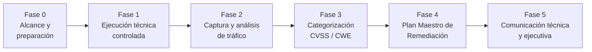

# 🕵️ Ethical Hacking: Plan Maestro de Remediación para un E-commerce

[](https://www.kali.org/)
[](https://www.zaproxy.org/)
[](https://www.wireshark.org/)
[](https://faradaysec.com/)
[]()
[](./LICENSE)
[]()

> Campaña de hacking ético **no intrusiva** sobre el canal de comercio electrónico de una PYME distribuidora, gestionada como un pentest profesional: ficha de campaña, bitácora, trazabilidad en **Faraday**, matriz **CVSS v3.1 / CWE** y un **Plan Maestro de Remediación** con prioridades, esfuerzo, responsables y forma de validación.

> 🔒 **Confidencialidad:** el trabajo se hizo para una empresa real en el marco de Vinculación con el Medio. **El nombre de la empresa, el dominio, las direcciones IP y cualquier dato que permita identificar el sitio fueron eliminados de este repositorio.**

---

## 📋 Tabla de contenidos

- [Alcance y reglas de compromiso](#-alcance-y-reglas-de-compromiso)
- [Metodología](#-metodología)
- [Herramientas](#️-herramientas)
- [Matriz de vulnerabilidades](#-matriz-de-vulnerabilidades)
- [Plan Maestro de Remediación](#-plan-maestro-de-remediación)
- [Estructura del repositorio](#-estructura-del-repositorio)
- [Aprendizajes](#-aprendizajes)
- [Autora](#-autora)

---

## 🎯 Alcance y reglas de compromiso

| ✅ Dentro de alcance | ❌ Fuera de alcance |
|---|---|
| Observación **pasiva** del sitio público | Escáneres agresivos, *fuzzing*, fuerza bruta |
| Reconocimiento de puertos, DNS y cabeceras | Explotación activa sobre producción |
| Verificación del certificado y de los protocolos TLS | Pruebas de carga o de denegación de servicio |
| Enumeración de recursos no destructiva | Uso de credenciales, tokens o datos reales de clientes |
| Análisis pasivo con OWASP ZAP | |
| Validaciones activas **replicadas en un laboratorio** autorizado | |

**Criterios de detención:** ante cualquier comportamiento inesperado, la actividad se detenía y se escalaba al docente. Toda la evidencia se depuraba de datos sensibles antes de pasar al informe.

---

## 🧭 Metodología



- Cada hallazgo tiene un ID único (**VULN-01 a VULN-07**) que se mantiene igual en la bitácora, en Faraday, en la matriz y en el plan. Así hay trazabilidad completa.
- La campaña se registró en **Faraday** con el activo, el servicio, la severidad y el estado de cada hallazgo.
- El informe tiene **dos niveles de lectura**: un resumen ejecutivo para la gerencia y un detalle técnico reproducible para el equipo de TI.

---

## 🛠️ Herramientas

| Categoría | Herramienta | Uso |
|---|---|---|
| Descubrimiento | Nmap (`ssl-enum-ciphers`) | Puertos, servicios y cifrados TLS |
| Host y cabeceras | `dig`, `curl -I` | Resolución DNS y cabeceras de seguridad HTTP |
| Capa de transporte | OpenSSL (`s_client -tls1`, `-tls1_1`) | Validación dirigida de protocolos obsoletos |
| Aplicación web | OWASP ZAP (pasivo) | Cookies, CSP y cabeceras |
| Enumeración | DIRB, `robots.txt` | Rutas y recursos (no destructivo) |
| Tráfico | Wireshark | Corroboración del handshake TLS |
| Gestión | Faraday | Registro y seguimiento de la campaña |

---

## 🚨 Matriz de vulnerabilidades

| ID | Hallazgo | CWE | CVSS v3.1 | Estado | Prioridad |
|---|---|---|---|---|---|
| **VULN-01** | **TLS 1.0 y TLS 1.1 habilitados** | CWE-327 | 🟡 5.3 Media | ✅ Confirmado (Nmap + OpenSSL + Wireshark) | **Alta** |
| VULN-02 | Cookie de sesión sin `HttpOnly` | CWE-1004 | 🟡 4.3 Media | Detectado (pasivo) | Media |
| VULN-03 | Cookie de sesión sin `Secure` | CWE-614 | 🟡 4.3 Media | Detectado (pasivo) | Media |
| VULN-04 | Cookie de sesión sin `SameSite` | CWE-1275 | 🟡 4.3 Media | Detectado (pasivo) | Media |
| VULN-05 | Sin cabecera **HSTS** | CWE-319 | 🟢 3.1 Baja | ✅ Confirmado (`curl -I`) | Baja |
| VULN-06 | Sin `X-Content-Type-Options` | CWE-693 | Informativa | Observación preventiva | Baja |
| VULN-07 | **CSP** permisiva (`unsafe-inline`) | CWE-693 | Informativa | Observación preventiva | Media |

**Conclusión principal:** no se encontraron vulnerabilidades críticas ni evidencia de compromiso. El hallazgo más relevante es la **aceptación de TLS obsoleto**, que confirmé con **tres fuentes independientes**. El resto son oportunidades de *hardening*.

> 📌 **CVE ≠ CWE ≠ CVSS.** VULN-01 no tiene CVE porque es una configuración, no un defecto de software publicado. Ninguna alerta pasiva se presentó como explotación confirmada.

---

## 🗺️ Plan Maestro de Remediación

| ID | Medida de hardening | Esfuerzo | Beneficio | Plazo | Responsable | Validación |
|---|---|---|---|---|---|---|
| VULN-01 | Permitir solo TLS 1.2+ con cifrados AEAD | Bajo–Medio | Alto | ≤ 30 días | Infra / DevOps | `nmap --script ssl-enum-ciphers`, `openssl s_client -tls1` debe fallar |
| VULN-02 | `HttpOnly` en las cookies de sesión | Bajo | Alto | ≤ 30 días | Backend | Revisar `Set-Cookie` |
| VULN-03 | `Secure` en las cookies de sesión | Bajo | Alto | ≤ 30 días | Backend | Revisar `Set-Cookie` |
| VULN-04 | `SameSite=Lax` (o `Strict`) | Bajo | Medio–Alto | ≤ 30 días | Backend | `Set-Cookie` + pruebas de login y checkout |
| VULN-05 | `Strict-Transport-Security` | Bajo | Medio | ≤ 30 días | Infra / DevOps | `curl -I` |
| VULN-06 | `X-Content-Type-Options: nosniff` | Bajo | Medio | ≤ 30 días | DevOps / Dev | `curl -I` |
| VULN-07 | CSP con *nonces* o *hashes*, sin `unsafe-inline` | Medio | Alto | 30–90 días | AppSec | Nuevo análisis con ZAP + pruebas funcionales |

**Secuencia:** **Etapa 1 (0–30 días)**: VULN-01 a VULN-06, cambios de configuración de bajo esfuerzo que se pueden hacer en un ciclo normal de mantenimiento. **Etapa 2 (30–90 días)**: VULN-07, que requiere coordinarse con desarrollo.

📄 En [`remediacion/`](./remediacion) hay configuraciones de ejemplo para Nginx y Apache.

---

## 📁 Estructura del repositorio

```
.
├── README.md
├── LICENSE
├── docs/
│   └── comandos_validacion.md         # Comandos de verificación por hallazgo
└── remediacion/
    ├── nginx-hardening.conf.example   # TLS 1.2+, HSTS, nosniff, CSP
    └── apache-hardening.conf.example  # Equivalente para Apache httpd
```

---

## 💡 Aprendizajes

- ✅ **Hacking ético también es saber dónde detenerse.** Alcance, exclusiones y criterios de detención definidos antes de empezar.
- ✅ **Corroborar con varias fuentes** (Nmap + OpenSSL + Wireshark) antes de confirmar un hallazgo.
- ✅ **Gestionar una campaña** con bitácora, IDs y una plataforma (Faraday) para que la remediación tenga seguimiento.
- ✅ **Comunicar a dos audiencias:** riesgo de negocio para la gerencia y pasos reproducibles para TI.

---

## 👩‍💻 Autora

**Catalina Rebolledo Rojas** · [@Cataliniwis](https://github.com/Cataliniwis)

Asignatura *Ethical Hacking* · Técnico en Ciberseguridad
Instituto Profesional San Sebastián · 2026

---

## 📄 Licencia

Este proyecto se distribuye bajo la licencia MIT. Ver [LICENSE](./LICENSE).

---

> ⚠️ **Disclaimer:** evaluación académica no intrusiva con autorización docente. Las pruebas activas se hicieron solo en un entorno controlado. Este repositorio no contiene datos que permitan identificar a la organización evaluada.
